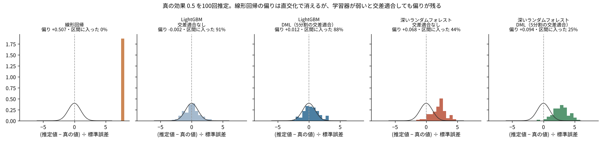

# P04 機械学習で交絡を取ると、効果はどこまで正しく出るのか？ 線形回帰の偏り0.51は消えたが、学習器が弱いと交差適合しても偏りが残った

## この記事で分かること
Double/Debiased Machine Learning（DML）は、交絡（結果と施策の両方に効く要因）を機械学習で取り除きつつ、施策の効果を正しい誤差の幅つきで出す方法です。真の効果が分かっているシミュレーションで、線形回帰・交差適合なし・DML を比べました。DML の2つの工夫のうち、「直交化」は大きく効き、「交差適合」の効き目は機械学習の当たり方しだいでした。

## 読んだ論文
- Victor Chernozhukov, Denis Chetverikov, Mert Demirer, Esther Duflo, Christian Hansen, Whitney Newey, James Robins（2018）「Double/debiased machine learning for treatment and structural parameters」The Econometrics Journal 21(1)。https://arxiv.org/abs/1608.00060

## 論文の問い
交絡の要因が多かったり、効き方が曲がっていたりすると、線形回帰では取り除ききれません。機械学習なら曲がった関係も当てられます。ところが、機械学習の予測をそのまま使って効果を推定すると、正則化（当てはめすぎを防ぐための抑え）や当てはめすぎのせいで推定が偏り、信頼区間も正しくなくなります。論文は、どうすれば機械学習を使っても効果を正しく推定できるかを示しました。

## 論文の考え方
- **直交化（両方から引く）**：結果 Y から「X で説明できる分」を機械学習で引き、施策 D からも「X で説明できる分」を引きます。残った Y の残差を、残った D の残差で回帰します。両方から引くと、機械学習の小さな誤差が効果の推定にほとんど響かなくなります（誤差が「かけ算」でしか入らない）
- **交差適合（cross-fitting）**：データを分け、ある部分の残差は、ほかの部分で学習したモデルで計算します。自分のデータで学習して自分の残差を作ると、当てはめすぎが残差を小さくし、推定を偏らせるからです
- 条件：2つの機械学習（Y の予測と D の予測）の誤差が十分小さいこと。片方ずつは大まかでよいが、2つの誤差のかけ算が小さくないといけません

## 手元で試す
- 部分線形モデル：Y = 0.5×D + 1.5×h(X) + ノイズ、D = h(X) + ノイズ。h(X) は sin・2乗・かけ算を含む曲がった関数で、X は5列。真の効果は0.5。1,000件を種を固定して100回
- 比べた5つ：線形回帰（X を1次で入れる）／LightGBM で直交化・交差適合なし／LightGBM で DML（5分割）／葉に1件まで残す深いランダムフォレストで直交化・交差適合なし／同じく DML
- 標準誤差は残差の回帰の式から出し、95%区間に0.5が入った割合を数えました



線形回帰は（推定値−真の値）÷標準誤差がおよそ15になり、図では右端の8の位置にまとめて描いています。

## 分かったこと
1. **線形回帰は大きく偏り、直交化で偏りは消えた。** 線形回帰の推定の平均は1.007（偏り＋0.51）で、95%区間に真の値が入ったのは0%でした。LightGBM で両方から引くと、交差適合なしで0.498、DML で0.512になりました
2. **交差適合の効き目は小さかった。** LightGBM では、交差適合なし（区間に入った割合91%）と DML（88%）にほぼ差がありませんでした。今回の LightGBM は木を少しずつ足す設定で、学習データを丸暗記しにくかったためとみています（推測）
3. **学習器が弱いと、交差適合しても偏りが残った。** 深いランダムフォレストでは、交差適合なしで偏り＋0.068（区間に入った割合44%）、DML で＋0.094（25%）でした。ランダムフォレストは h(X) の曲がりを取り切れず、Y と D の残差に同じ取り残しが入り、推定が上にずれます。交差適合すると学習に使えるデータが減り、取り残しがむしろ増えました

## 論文の限界と、試して分かった落とし穴
- 論文の保証は「機械学習が十分よく当たる」ことが前提です。今回の深いランダムフォレストのように当たりが悪いと、DML でも区間は正しくなりません
- どの学習器がよいかは、データごとに確かめるしかありません。Y と D の予測の当たり方（交差適合での誤差）を報告するのが大事です
- 交絡の要因をすべて X に入れていることが前提です。見えていない交絡は、DML でも取り除けません

## 仕事で使うなら
- 施策の効果を回帰で出すとき、交絡の効き方が曲がっていそうなら、DML を並べて比べる。結果が大きく違えば、線形回帰の形を疑う
- Y と D を予測する学習器を2〜3種類試し、効果の推定がどれだけ動くかを見る
- このリポジトリの [F16](../../articles/F16_childcare_dml)（保育所と女性の就業）でも DML を使った。そこでも学習器を変えたときの動きを見ている

## 関連する論文と、次に読むもの
- Wager, Athey（2018）因果フォレスト：人ごとの効果。[P05](../P05_causal_forest) で試した
- Bach ら「DoubleML」の Python パッケージの解説（実装と使い方）
- Chernozhukov ら（2022）「Locally robust semiparametric estimation」Econometrica（直交化の一般論）

## 用語のメモ
- 交絡：施策を受けるかどうかと、結果の両方に効く要因。放っておくと、施策の効果と要因の効果が混ざる
- 部分線形モデル：結果を「施策の効果×施策」と「要因で決まる部分」の足し算で表す形。要因の部分はどんな形でもよい
- 直交化：結果と施策の両方から、要因で説明できる分を引いてから比べること。機械学習の誤差が効果の推定に響きにくくなる
- 交差適合：データを分け、ある部分の予測は別の部分で学習したモデルで作ること。自分のデータを丸暗記した予測を使わないための工夫
- 標準誤差：推定値がデータの取り方でどれだけ揺れるかの目安。±1.96倍が、だいたいの95%区間

## 言えないこと
- 論文の実験を再現したのではなく、同じ考え方を自分で書いた短いコードで試しました（DoubleML などのパッケージは使っていません）
- 1つの設定（1,000件・5列・曲がり方1種類）だけです。件数が増えれば、ランダムフォレストの偏りも小さくなるはずです（推測）
- 区間に入った割合は100回から出したもので、±5ポイントほどの揺れがあります

## 再現のしかた・出典
```
pip install -r requirements.txt
cd src && python p04_dml.py   # 2コアで15分ほど
```
- 出典：上の論文。データはすべてシミュレーション（種は固定）
