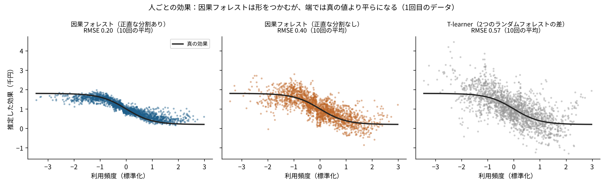

# P05 因果フォレストは、人によって違う効果をどこまで当てられるのか？ 「正直な分割」で外れが半分になり、90%の区間は87%当たった

## この記事で分かること
施策の効果は、人によって違います。因果フォレストは、ランダムフォレストを「効果の違い」を見つけるように作り替えた方法です。架空の会員にクーポンを配った場面で、人ごとの効果（CATE）をどこまで当てられるか、区間はどれだけ信じられるかを試しました。

## 読んだ論文
- Stefan Wager, Susan Athey（2018）「Estimation and Inference of Heterogeneous Treatment Effects using Random Forests」Journal of the American Statistical Association 113(523)。https://arxiv.org/abs/1510.04342

## 論文の問い
平均の効果（ATE）なら、差の差や回帰で推定できます。でも「誰に効いたか」を知りたいとき、特徴量が多いと、どこで分ければよいかが分かりません。機械学習で効果の違いを見つける方法はありましたが、推定に誤差の幅（信頼区間）を付けられませんでした。論文は、ランダムフォレストを少し変えると、効果の推定に正しい幅を付けられることを示しました。

## 論文の考え方
- **効果の違いで分ける木**：ふつうの決定木は「予測が当たるように」分けます。因果フォレストは「分けた2つのグループで効果がいちばん違うように」分けます
- **正直な分割（honesty）**：データを2つに分け、片方で「どこで分けるか」を決め、もう片方で「各グループの効果」を計算します。同じデータで分け方と効果の両方を決めると、たまたま効果が大きく見えたところで分けてしまい、効果を大きく見積もるからです
- **たくさんの木の平均**：小さく取り出したデータで木をたくさん作り、平均します。こうすると推定は正規分布に近づき、区間が付けられる、というのが論文の中心の結果です
- 交絡（配る人が特徴量で決まる）があるときは、配られやすさと結果の予測を先に引いてから効果を推定する形（後の研究の「一般化ランダムフォレスト」や、econml の CausalForestDML）が使われます

### なぜ「正直な分割」が要るのか（小さな例）
効果がどこでも同じ（たとえば全員1千円）でも、データにはばらつきがあります。100人を「利用頻度が高い50人・低い50人」に分けると、たまたま高い側の平均の差が1.3千円、低い側が0.7千円と出ることがあります。分け方を決めるときは、この「たまたま差が大きく見える分け方」が選ばれやすくなります。同じデータでそのまま効果を計算すると、「高い人によく効く」という、実はない違いを報告してしまいます。分け方を決めるデータと、効果を計算するデータを別にすれば、この思い込みは入りません。その代わり、1本の木で使えるデータは半分になります。

## 手元で試す
- 場面：架空の会員6,000人に割引クーポンを配る。真の効果（月の購入額の増え方）は、利用頻度が高い人ほど小さくなる形（0.2〜1.8千円）にしました。よく使う人ほど配られやすく、交絡があります。別の2,000人で当たり方を測りました。種を固定して10回
- 比べたもの：econml 0.17 の CausalForestDML（正直な分割あり／なし）と、配った人・配らなかった人で別々にランダムフォレストを作って差をとる方法（T-learner）



## 分かったこと
1. **正直な分割ありが、いちばん当たった。** 人ごとの効果の外れ（RMSE）は、正直な分割ありが0.20、なしが0.40、T-learner が0.57でした。真の効果との相関は0.93・0.77・0.67でした
2. **90%の区間は87%当たった。** 正直な分割ありの90%区間に真の効果が入った割合は87.3%で、少し足りませんでした。区間の幅は平均0.66千円でした。分割なしは94.6%入りましたが、幅が1.71千円と2.6倍も広く、使いにくい区間でした
3. **平均の効果は、どの方法でもほぼ当たった。** 平均の効果のずれは、因果フォレストで0.006千円、T-learner で0.027千円でした。差が出るのは「誰に効いたか」のほうです

## 論文の限界と、試して分かった落とし穴
- 図のように、効果の形の端（利用頻度がとても低い・高い人）では、推定が真の値より平らになります。端のデータが少ないためです
- 区間が正しくなるのは、データが十分多いときです。今回の6,000人でも90%に少し届きませんでした
- 交絡を取り除けるのは、配られ方を決めた特徴量をすべて持っているときだけです
- T-learner は、配った人・配らなかった人で別々に予測を作るので、2つの予測の誤差がそのまま効果の誤差に足されます。今回は配った人のほうが利用頻度の高い人に偏っていて、片方のモデルが苦手な範囲ができたことも、外れが大きくなった理由とみています（推測）

## 仕事で使うなら
- 「誰に配るか」を決める前に、因果フォレストで効果の違いの形を見る。ただし、狙いを絞る判断は、絞った配り方の実験で確かめる
- 人ごとの値より、グループ（例：利用頻度の高・中・低）の平均の効果と幅を報告する
- 平均の効果だけ知りたいなら、因果フォレストを使う必要はない。差の差や回帰のほうが説明しやすい
- 区間の当たり方を、自分のデータに近いシミュレーションで一度確かめておく（今回なら87%だった）

## 関連する論文と、次に読むもの
- Athey, Tibshirani, Wager（2019）「Generalized Random Forests」Annals of Statistics
- Chernozhukov ら（2018）Double/Debiased ML：[P04](../P04_double_ml) で試した
- このリポジトリの [F17](../../articles/F17_minwage_causal_forest)（因果フォレストで最低賃金の県ごとの効果を見たもの）

## 用語のメモ
- CATE（条件付き平均処置効果）：特徴量が同じ人たちの中での、施策の平均の効果。「この条件の人には、どれだけ効くか」
- ATE（平均処置効果）：全員をならした効果
- T-learner：施策を受けた人・受けなかった人で別々に予測モデルを作り、2つの予測の差を効果とする方法
- 正直な分割（honesty）：木の分け方を決めるデータと、効果を計算するデータを別にすること
- 区間の当たり方（カバー率）：90%区間に真の値が入った割合。90%に近いほど、区間の幅が信じられる

## 言えないこと
- 論文の実験を再現したのではなく、econml の実装で同じ考え方を試しました。econml の「正直な分割なし」の区間の作り方は、論文の理論の外にあります
- 効果の形は1種類（なめらかに下がる形）だけです。段のある形や、効く特徴量が多い場合は試していません
- 10回の平均で、回ごとのばらつきは results/sims.csv にあります

## 再現のしかた・出典
```
pip install -r requirements.txt
cd src && python p05_cf.py
```
- 出典：上の論文。データはすべて架空（種は固定）。使った実装：econml 0.17.0 の CausalForestDML
