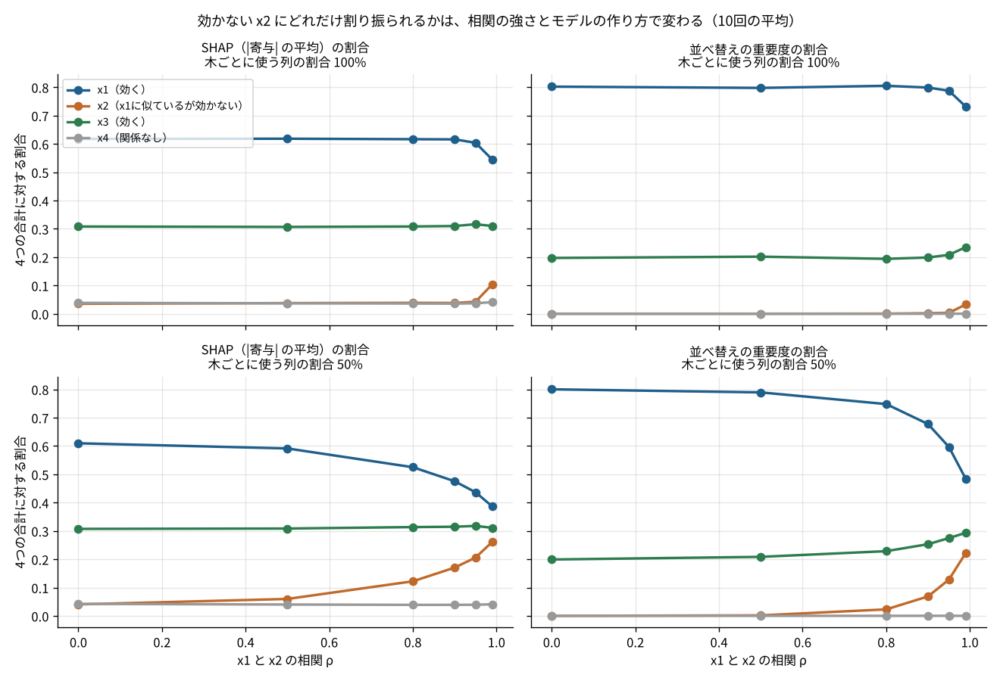

# P06 SHAP の「重要度」は、似た特徴量があるとどう分かれるのか？ 効かない列にも最大26%が割り振られ、量り方で比も2倍違った

## この記事で分かること
SHAP（シャップ）は、機械学習の予測を「どの特徴量がどれだけ押し上げたか」に分ける方法です。とても便利ですが、よく似た特徴量が2つあると、効いていない方にも重要度が付きます。どれだけ付くかは、相関の強さだけでなく、モデルの作り方でも変わりました。

## 読んだ論文
- Scott M. Lundberg, Su-In Lee（2017）「A Unified Approach to Interpreting Model Predictions」NeurIPS 2017。https://arxiv.org/abs/1705.07874

## 論文の問い
予測の理由を説明する方法は、LIME やいくつかの「寄与の分け方」など、たくさんありました。それぞれ答えが違い、どれを信じればよいか分かりませんでした。論文は、これらを「特徴量ごとの寄与を足すと予測になる形」という1つの枠にまとめ、その中で望ましい性質を満たす分け方は1つしかないことを示しました。

## 論文の考え方
- もとになっているのは、ゲーム理論のシャープレイ値です。何人かで協力して得た成果を、「その人が加わったときに増えた分」を、加わる順番すべてについて平均して分けます
- 特徴量を「人」、予測を「成果」と見ると、特徴量ごとの寄与が決まります。寄与をすべて足すと「平均の予測からのずれ」にちょうど一致します
- 満たしてほしい性質は3つです。足すと予測に一致すること、使っていない特徴量の寄与は0になること、効き目が増えたら寄与も減らないこと。論文は、この3つを満たす分け方はシャープレイ値だけだと示しました
- ただし、全部の順番を数えると計算が重すぎます。論文はそのための近似（KernelSHAP など）を出し、決定木のモデル向けの速い計算（TreeSHAP）は後の論文で出ました。LightGBM の `pred_contrib=True` はこの TreeSHAP です

### 小さな例
予測の平均が100回で、ある動画の予測が160回だったとします。特徴量は「種類」と「長さ」の2つです。
- 種類だけを使うと140回、長さだけを使うと110回、両方を使うと160回になる、とします
- 種類を先に入れる順番では、種類の寄与は 140−100＝40、長さは 160−140＝20
- 長さを先に入れる順番では、長さの寄与は 110−100＝10、種類は 160−110＝50
- 2つの順番を平均すると、種類は45、長さは15。足すと60で、160−100 にちょうど一致します

特徴量が増えると順番の数が爆発的に増えるので、実際には近似や木のモデル向けの速い計算を使います。

## 手元で試す
- データ：種を固定したシミュレーション（4,000行、半分で学習・半分で計算）。y = 2×x1 + x3 + ノイズ。x2 は x1 と相関 ρ を持つが、y には効かない。x4 は何とも関係しない
- モデル：LightGBM。木ごとに使う列の割合（colsample_bytree）を100%と50%の2通り
- 比べたもの：SHAP（|寄与| の平均）と、並べ替えの重要度（その列だけをシャッフルしたときに誤差がどれだけ増えるか）
- ρ を 0〜0.99 の6通り、それぞれ10回



## 分かったこと
1. **効かない x2 にも重要度が付いた。** 列の割合50%のモデルでは、x2 の SHAP の割合は ρ=0.8 で12%、ρ=0.9 で17%、ρ=0.99 で26%でした。列の割合100%のモデルでは ρ=0.95 まで4%前後（関係のない x4 と同じくらい）で、ρ=0.99 で10%でした。同じデータでも、毎回すべての列から選べるモデルは x1 を選び続け、列を間引くモデルは x1 がないときに x2 を使うためです
2. **量り方で比が2倍違った。** 本当の効き目は x1 が x3 の2倍です。SHAP の割合は x1 62%・x3 31% でほぼ2倍、並べ替えの重要度は 80% と 20% で4倍でした（ρ=0、列100%）。SHAP は効き目の大きさに、並べ替えは誤差の増え方（効き目の2乗）に比例するためです
3. **関係のない x4 にも SHAP で4%前後付いた。** 並べ替えの重要度では0%でした。モデルが学習データのノイズに少し合わせ、その分が SHAP には出るためです。SHAP の小さな値を「少し効いている」と読まないほうがよいです

## 論文の限界と、試して分かった落とし穴
- シャープレイ値は「モデルがどう使ったか」を説明します。「世の中で何が効くか」（因果）は説明しません。x2 に寄与が付いても、x2 を変えれば y が変わるわけではありません
- 似た特徴量どうしでは、寄与の分かれ方はモデルの作り方しだいです。合計（x1＋x2）は安定でも、一つ一つは安定しません
- youtube-views-predictor の画面で出している寄与（倍率）も、同じ性質を持ちます。例えば「公開曜日」と「投稿間隔」が似た動きをすると、寄与はどちらかに寄ります（推測）

## 仕事で使うなら
- 相関の強い特徴量はまとめて（グループで）寄与を見る。どの組が強く相関しているかを、先に相関の表で確かめておく
- SHAP と並べ替えの重要度を両方出し、比が違うのは量り方の違いだと説明する
- 「寄与が大きい＝施策で動かせば効く」とは言わない。施策の効果は実験や因果推論で別に確かめる

## 関連する論文と、次に読むもの
- Lundberg ら（2020）「From local explanations to global understanding with explainable AI for trees」Nature Machine Intelligence（TreeSHAP）
- Janzing ら（2020）「Feature relevance quantification in explainable AI: A causal problem」AISTATS（似た特徴量の扱いの議論）
- Molnar「Interpretable Machine Learning」（無料の本）

## 用語のメモ
- 寄与：その特徴量が、平均の予測から「どれだけ押し上げ・押し下げたか」
- シャープレイ値：協力して得た成果を、加わる順番すべての平均で分ける方法。ゲーム理論の考え方
- 並べ替えの重要度：その列だけをシャッフルして、誤差がどれだけ増えるかで測る重要度
- pred_contrib：LightGBM が木のモデルについて寄与（TreeSHAP）を出す機能
- 相関：2つの値が一緒に動く度合い。1に近いほど、ほぼ同じ動きをする

## 言えないこと
- 論文の実験を再現したのではなく、同じ考え方をシミュレーションで試しました
- 2変数の相関だけの単純な設定です。特徴量が多く、相関がからみ合う実データでは、分かれ方はもっと読みにくくなります（推測）
- KernelSHAP（モデルを選ばない近似）は試していません

## 再現のしかた・出典
```
pip install -r requirements.txt
cd src && python p06_shap.py
```
- 出典：上の論文。データはすべてシミュレーション（種は固定）
- 関連：[youtube-views-predictor](https://github.com/takayuki-0127/youtube-views-predictor)（寄与の表示に pred_contrib を使用）
