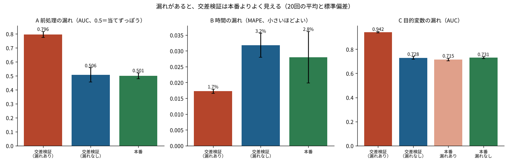

# P07 交差検証の成績は、どんなときに本番より良く見えるのか？ 漏れがあると AUC 0.80 が本番で 0.50、0.94 が 0.72 に落ちた

## この記事で分かること
「データの漏れ（leakage）」とは、本番で予測するときには使えない情報が、学習や検証にまぎれ込むことです。漏れがあると、交差検証の成績が本番より良く見えます。よくある3つの型を、種を固定したシミュレーションで作り、交差検証と本番の成績を並べました。

## 読んだ論文
- Sayash Kapoor, Arvind Narayanan（2022）「Leakage and the Reproducibility Crisis in ML-based Science」arXiv:2207.07048。https://arxiv.org/abs/2207.07048
- 漏れの考え方の元になった Shachar Kaufman, Saharon Rosset, Claudia Perlich, Ori Stitelman（2012）「Leakage in data mining: formulation, detection, and avoidance」ACM TKDD は、無料で読める正式な版を確かめられなかったので、題名と考え方の紹介にとどめ、本文は Kapoor と Narayanan を主に読みました

## 論文の問い
機械学習を使った研究で、「すごく当たる」と報告されたのに、ほかの人が試すと当たらない例が続いていました。Kapoor と Narayanan は17の分野を調べ、漏れによる誤りが329本の論文に見つかったことを集めました。漏れを8つの型に分け、論文を書くときに確かめる表（モデル情報シート）を提案しています。

## 論文の考え方
漏れの型は、大きく3つにまとまります。
- **学習用と検証用が分かれていない**：前処理（列の選び方・標準化・欠けた値の埋め方）を全データで行ってから分ける。同じ人や同じ日のデータが両方に入る
- **本番では使えない特徴量を使う**：結果が決まったあとに記録される値や、目的変数から作った値を入れる
- **検証のデータが本番と似ていない**：時間の順番を無視して混ぜる。本番とは違う集団で確かめる

大事なのは、「予測する時点で、その情報は本当に手に入るか」を1つずつ確かめることです。

## 手元で試す
3つの型を、それぞれ20回つくりました（種は固定）。
- **A 前処理の漏れ**：300件・1,000列。列はすべて乱数で、ラベルと関係ありません（正しい AUC は0.5）。全データでラベルと相関の高い20列を選んでから5分割の交差検証をする場合と、列の選び方も分割の中で行う場合を比べました
- **B 時間の漏れ**：2年分の日ごとの需要（ゆるい増加・週の波・前日に似る動き）。日付を混ぜた5分割と、時間の順に分けた検証を比べ、その後の90日（本番）の外れ（MAPE）と比べました
- **C 目的変数の漏れ**：架空の会員5,000人の解約。「解約手続きの問い合わせ件数」は、解約が決まってから増える値です。本番で予測する時点ではまだ起きていないので、0として入ってきます



## 分かったこと
1. **前処理の漏れで、当てずっぽうが「よく当たる」に見えた。** 全データで列を選ぶと交差検証の AUC は0.80、分割の中で選ぶと0.51、本番は0.50でした。ラベルと関係のない列でも、1,000列から相関の高いものを選ぶと、たまたま合う列がそろいます
2. **時間を混ぜると、外れが半分に見えた。** 日付を混ぜた交差検証の外れは1.7%、時間の順に分けた検証は3.2%、本番は2.8%でした。混ぜると、前後の日から「間をうめる」だけで当たってしまいます
3. **結果のあとに記録される値を入れると、本番でかえって悪くなった。** 交差検証の AUC は0.94でしたが、本番では0.72で、漏れのない特徴量だけのモデル（本番0.73）より低くなりました。モデルが問い合わせ件数に頼りきり、本番でそれが0になるためです

## 論文の限界と、試して分かった落とし穴
- 論文の表は研究向けです。業務では「予測する時点」が人によって違うことが多く、まずそれを決めないと漏れかどうか判断できません
- 時間の順に分けた検証（3.2%）は、本番（2.8%）より少し悲観的でした。いつも本番と一致するわけではありません
- 漏れは、交差検証の成績が良すぎるときに疑うのが入口です。ただ、良すぎない漏れもあります（C の漏れなしとの差は0.21）

## 仕事で使うなら
- 前処理（列の選択・標準化・埋め方）は、交差検証の中に入れる。scikit-learn なら Pipeline にまとめる
- 時間のあるデータは、時間の順に分けて確かめる。この検証の作り方は [F205](../../articles/F205_power_forecast_practice_part1) でも使った
- 特徴量の表に「いつ分かる値か」の列を作り、予測する時点より後の値を外す

## 関連する論文と、次に読むもの
- Kaufman ら（2012）：漏れの定義と、見つけ方・避け方の元の議論
- Roberts ら（2017）「Cross-validation strategies for data with temporal, spatial, hierarchical, or phylogenetic structure」Ecography（構造のあるデータの分け方）
- このリポジトリの [P10](../P10_forking_paths)（分析の選び方が増えると、有意が見つかりやすくなる話）

## 漏れを見つけるための質問（作る前に1つずつ）
- この特徴量は、予測する瞬間に、本当にもう手に入っているか。手に入る日時はいつか
- 前処理（選ぶ・埋める・そろえる）に、検証用のデータを使っていないか
- 同じ人・同じ店・同じ日が、学習用と検証用の両方に入っていないか
- 検証用のデータは、本番で予測する相手と同じ時期・同じ集団か
- 交差検証の成績が、似た問題の相場より良すぎないか

## 用語のメモ
- 交差検証：データをいくつかに分け、順番に1つを検証用にして成績を測るやり方
- AUC：2つのグループ（解約する／しない）を、予測の高い順にどれだけうまく並べられたか。0.5は当てずっぽう、1は完璧
- MAPE：外れの大きさを、実際の値に対する割合で平均したもの。小さいほどよい
- Pipeline：前処理とモデルを1つにまとめる scikit-learn の仕組み。交差検証の中で前処理もやり直してくれる
- 予測する時点：予測を使う瞬間。そこより後に分かる値は、特徴量にできない

## 言えないこと
- 論文の事例を再現したのではなく、漏れの型をシミュレーションで作って試しました
- どの型でも、漏れの大きさは設定（列の数・件数・自己相関の強さ）で変わります
- 実データでの漏れの多さは、この記事からは分かりません

## 再現のしかた・出典
```
pip install -r requirements.txt
cd src && python p07_leakage.py
```
- 出典：上の論文。データはすべてシミュレーション（種は固定）。会員と解約は架空
