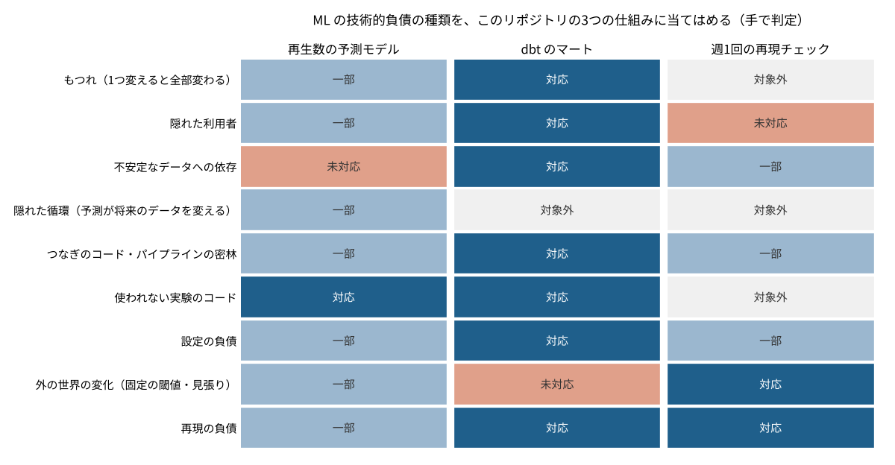

# P08 機械学習の「見えない借金」は、小さな仕組みにもたまるのか？ 3つの仕組みに当てはめると、予測モデルでは9種類のうち8種類が手つかずか一部だけだった

## この記事で分かること
機械学習の仕組みは、作るのは早くても、あとから直すのに手間がかかる「借金」をためやすい、という論文があります。そこに挙がった借金の種類を、このリポジトリにある3つの小さな仕組みに当てはめて、どこに借金がたまっているかを手で確かめました。

## 読んだ論文
- D. Sculley, Gary Holt, Daniel Golovin, Eugene Davydov, Todd Phillips, Dietmar Ebner, Vinay Chaudhary, Michael Young, Jean-François Crespo, Dan Dennison（2015）「Hidden Technical Debt in Machine Learning Systems」NeurIPS 2015。https://papers.nips.cc/paper_files/paper/2015/hash/86df7dcfd896fcaf2674f757a2463eba-Abstract.html

## 論文の問い
ソフトウェアの「技術的負債」は、急いで作ったときの手抜きが、あとで直すときの利子になる、という考え方です。論文は、機械学習の仕組みには、ふつうのソフトウェアにはない借金があると指摘しました。モデルのコードは仕組み全体のごく一部で、まわりのデータの流れ・設定・見張りに借金がたまる、という主張です。

## 論文の考え方
論文が挙げた主な借金を、やさしく言い換えます。
- **もつれ**：特徴量を1つ変えると、ほかの特徴量の効き方も、予測全体も変わる。「1つ変えると全部変わる」
- **隠れた利用者**：予測の結果を、作った人の知らないところで別の仕組みが使っている
- **不安定なデータへの依存**：入力のデータの形や意味が、別のチームの都合で変わる
- **隠れた循環**：予測を見て人の動きが変わり、それが次の学習データを変える
- **つなぎのコード・パイプラインの密林**：部品どうしをつなぐコードや、前処理の分かれ道が増えすぎる
- **使われない実験のコード**：試しに入れた分かれ道が残り、知らないうちに動く
- **設定の負債**：閾値やパラメータがコードのあちこちに散らばる
- **外の世界の変化**：固定の閾値が古くなる。見張りがないと気づけない

論文はこのほか、再現できないこと（再現の負債）も借金に挙げています。

## 手元で試す
このリポジトリにある3つの仕組みに、上の9種類を当てはめました。判定は「対応・一部・未対応・対象外」の4つで、根拠を1行ずつ `data/debts.csv` に書きました。
- **再生数の予測モデル**：自分の YouTube の動画の再生数を、公開前の情報で予測するアプリ（[youtube-views-predictor](https://github.com/takayuki-0127/youtube-views-predictor)）。11月に見張りと作り直しの仕組みを足した
- **dbt のマート**：架空の小売の月次レポートの定義を、dbt と DuckDB のマートに1回だけ書いたもの（[projects/dbt_retail_mart](../../projects/dbt_retail_mart)）
- **週1回の再現チェック**：551番以降の記事のコードを GitHub Actions で毎週流し直し、結果が一致するかを確かめる仕組み（[tools/repro_check.py](../../tools/repro_check.py)）



## 分かったこと
1. **予測モデルには借金が広くたまっていた。** 9種類のうち「対応」は1つ（使われない実験のコード）だけで、7つが「一部」、1つが「未対応」（入力の CSV の形が変わると動かない）でした
2. **dbt のマートは、借金を前もって減らす形になっていた。** 9種類のうち7つが「対応」でした。定義を1か所に書く、層に分ける、形のテストを付ける、というやり方が、論文の挙げる借金の多くにそのまま効いていました。ただし、本番のデータが届く仕組みがないので、外の世界の変化は見張れていません
3. **再現チェックは「外の世界の変化」に強いが、利用者が決まっていない。** 毎週自動で流して不一致を失敗にするので、ライブラリの更新で結果が変わればすぐ分かります。一方で、結果を誰が見て、どう直すかは決めていません

## 論文の限界と、試して分かった落とし穴
- 論文は大きな会社の大きな仕組みを念頭に置いています。小さな仕組みでは「隠れた利用者」や「もつれ」はまだ小さく、判定が甘くなりがちです（推測）
- 判定は作った本人が手で付けたもので、別の人が見ると変わります
- 予測モデルの「隠れた循環」は、自分のチャンネルでは特に起きやすいと考えています。予測を見て動画の作り方を変えれば、次の学習データがその影響を受けるからです（推測）

## 仕事で使うなら
- 新しい仕組みを作るときに、この9種類を点検表として使う。特に「入力の形の確かめ」と「設定を1か所にまとめる」は、最初に入れても手間が小さい
- 予測を使う人・仕組みの一覧を書いておく（dbt なら exposure）
- 見張りは「作った」で終わらせず、実際に回して記録を残す。点数の付け方は [P09](../P09_ml_test_score) で試した

## 関連する論文と、次に読むもの
- Breck ら（2017）「The ML Test Score」：同じ著者たちによる、本番に出す前の28項目の点検表。[P09](../P09_ml_test_score) で採点した
- Sculley ら（2014）「Machine Learning: The High-Interest Credit Card of Technical Debt」：この論文の前の版

## 用語のメモ
- 技術的負債：急いで作ったときの手抜きが、あとで直す手間（利子）として返ってくること
- exposure：dbt で「このデータを誰が・何に使っているか」を書いておく仕組み
- 閾値：「この値を超えたら合図を出す」という境目の値
- 再現：同じコードとデータで、同じ結果が出ること
- マート：使う目的に合わせて整えたデータの置き場

## 言えないこと
- 論文の主張を確かめたのではなく、借金の種類を点検表として小さな仕組みに当てはめただけです
- 3つの仕組みは目的も大きさも違うので、どれがよいかを比べるものではありません

## 再現のしかた・出典
```
pip install -r requirements.txt
cd src && python p08_debt.py   # data/debts.csv から集計と図を作る
```
- 出典：上の論文。判定は data/debts.csv（根拠つき）
