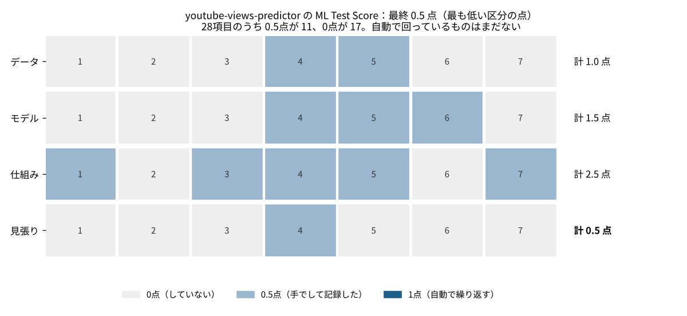

# P09 自分の予測アプリは、本番に出せる点検をどこまで済ませているのか？ 28項目で採点すると0.5点で、自動で回っている点検は1つもなかった

## この記事で分かること
機械学習のモデルを本番で使う前に確かめることを28項目にまとめ、点数を付ける方法があります。自分の YouTube 再生数の予測アプリを、その28項目で正直に採点しました。結果は0.5点で、論文の目安では「テストはあるが、信頼性に大きな穴がありうる」段階でした。

## 読んだ論文
- Eric Breck, Shanqing Cai, Eric Nielsen, Michael Salib, D. Sculley（2017）「The ML Test Score: A Rubric for ML Production Readiness and Technical Debt Reduction」IEEE Big Data 2017。https://research.google/pubs/the-ml-test-score-a-rubric-for-ml-production-readiness-and-technical-debt-reduction/

## 論文の問い
機械学習の仕組みは、ふつうのソフトウェアのテストだけでは足りません。データが変わる、学習と本番で特徴量がずれる、モデルが古くなる、といった問題があるからです。では、何をどこまで確かめれば「本番に出せる」と言えるのか。論文は、大きな会社で使われてきた点検をもとに、具体的な28項目と点数の付け方を出しました。

## 論文の考え方
- 28項目は4つの区分に7つずつあります：特徴量とデータ／モデルの開発／機械学習の仕組み（インフラ）／見張り
- 点数の付け方：手で行い、結果を記録して共有していれば0.5点。自動で繰り返し行っていれば1点
- 区分ごとに合計し、**最終の点は4つの区分のうち最も低い点**にします。どこか1つでも手を抜くと、全体の点が上がらないようにするためです
- 目安：0点は研究に近い段階、1点まではテストはあるが大きな穴がありうる、2点までは本番向けの最初の一歩、3点までは十分にテストされている、5点までは重要な仕組みにも使える強さ、それ以上は特に優れている

## 手元で試す
採点したのは [youtube-views-predictor](https://github.com/takayuki-0127/youtube-views-predictor)（公開前の情報から再生数を予測する Streamlit のアプリ）です。11月に、公開後の当たり方を見張る `monitor.py` と、作り直したモデルがよいときだけ入れ替える `retrain.py` を足しました。28項目すべてに、点と根拠を1行ずつ付けました（`data/scores.csv`）。甘くならないよう、「仕組みはあるが、実データではまだ回していない」ものは0点にしました。



## 分かったこと
1. **最終の点は0.5点。** 区分ごとの合計は、データ1.0点、モデル1.5点、仕組み2.5点、見張り0.5点で、いちばん低い「見張り」が全体の点になりました
2. **自動で回っている点検は0。** 0.5点（手でして記録した）が11項目、0点が17項目で、1点は1つもありませんでした。どれも「手で1回確かめて README に書いた」段階です
3. **「もっと簡単なモデルのほうがよくはない」は、確かめたら簡単なほうが少しよかった。** 重回帰の誤差（RMSE 1.271）は LightGBM（1.283）とほぼ同じで、わずかに小さい値でした。点検は「した」ので0.5点ですが、結果は LightGBM を使う理由が弱いことを示しています

## 論文の限界と、試して分かった落とし穴
- 28項目は、大きな会社で多くの人が使う仕組みを念頭に置いています。一人で作るアプリでは、「人に設定を見てもらう」「一部の利用者で試してから出す」などは、そもそもやりようがありません
- 点の付け方が「手で1回したか」「自動で繰り返すか」の2段だけなので、記録の質までは測れません
- 最終の点を最も低い区分にする決まりは厳しく、1つの区分を上げるだけで全体が動きます。今回なら見張りを上げれば、ほかを変えなくても最大1.0点になります

## 仕事で使うなら
- 次に上げるなら、見張りの区分から。monitor.py を毎月自動で回す（GitHub Actions など）だけで、2〜3項目が1点に近づく（推測）
- 依存するライブラリの版を固定し、更新の知らせを受ける（Dependabot など）
- 簡単なモデルとの比較は、毎回の作り直しで自動にする。今回のように差がないなら、説明しやすい重回帰を使う判断もありえる

## 関連する論文と、次に読むもの
- Sculley ら（2015）「Hidden Technical Debt in Machine Learning Systems」：同じ著者たちの、借金の種類の論文。[P08](../P08_ml_technical_debt) で当てはめた
- Polyzotis ら（2017）「Data Management Challenges in Production Machine Learning」：データの点検の話

## 点を上げる順番（試算）
最終の点は最も低い区分で決まるので、見張りの区分から上げるのが近道です。
1. monitor.py を月1回、GitHub Actions で自動で回す → 「予測の当たり方が落ちていない」「古くなりすぎていない」が1点に近づく
2. 次に作り直すときに学習時の分布を meta.json に残す → 「入力のデータの決まり」を確かめられるようになる
3. requirements.txt の版を固定し、更新の知らせを受ける → 「依存の変化の知らせ」
この3つで見張りは0.5点から2点以上になり、最終の点はデータの区分（1.0点）で頭打ちになります（推測）。その次は、特徴量のテストと値の範囲の表（データの区分）です。

## 用語のメモ
- 本番：予測を実際の判断に使う環境。手元の実験と違い、毎日データが入れ替わる
- 見張り（モニタリング）：本番で、入力のデータや予測の当たり方が変わっていないかを確かめ続けること
- 学習と本番のずれ：学習のときと本番のときで、同じはずの特徴量が違う計算になること
- カナリア：新しいモデルを一部の利用者だけで先に試すこと
- ロールバック：前のモデルに戻すこと

## 言えないこと
- 採点は作った本人が手で付けたものです。根拠は data/scores.csv に書きましたが、別の人が付けると0.5点ほど動く項目があると思います（推測）
- 論文の28項目の文言は自分の言葉で言い換えました。正確な定義は論文を確かめてください

## 再現のしかた・出典
```
pip install -r requirements.txt
cd src && python p09_score.py   # data/scores.csv から集計と図を作る
```
- 出典：上の論文。採点は data/scores.csv
