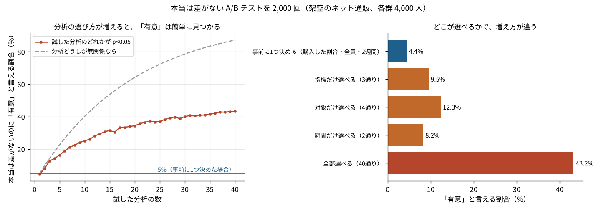

# P10 本当は差がない A/B テストで、分析の選び方が増えると何が起きるのか？ 選べる道が40通りあると、43%で「有意」が見つかった

## この記事で分かること
「指標はどれにするか」「対象を新規客に絞るか」「外れ値を切るか」。分析には、もっともらしい選び方がたくさんあります。わざと何度も検定しなくても、データを見ながら選ぶだけで、「有意」な結果は見つかりやすくなります。本当は差がない A/B テストを2,000回作って、どれだけ増えるかを数えました。

## 読んだ論文
- Andrew Gelman, Eric Loken（2013）「The garden of forking paths: Why multiple comparisons can be a problem, even when there is no "fishing expedition" or "p-hacking" and the research hypothesis was posited ahead of time」。http://www.stat.columbia.edu/~gelman/research/unpublished/p_hacking.pdf
- 一般向けの短い版：Gelman, Loken（2014）「The Statistical Crisis in Science」American Scientist

## 論文の問い
「p値を小さくするために何度も試した（p ハッキング）」なら問題だ、という話はよく知られています。論文は、もっと気づきにくい問題を指摘しました。分析者が1回しか検定していなくても、「データを見てから、どの分析をするかを決めた」なら、ほかの道を選んでいた可能性も含めて考えないといけない、という問題です。

## 論文の考え方
- 分析には、たくさんの分かれ道があります（指標・対象・除外・期間・変数の作り方など）
- どの道も、それだけ見ればもっともらしい。分析者は悪気なく、データに合いそうな道を選びます
- すると、「もしデータが違っていたら、別の道を選んでいた」ことになります。検定の前提（分析の手順は前もって決まっている）が崩れ、5%のはずの誤りが増えます
- 論文がすすめるのは、分析を前もって決めておくこと、見つかった結果を新しいデータで確かめること、すべての道の結果をまとめて示すこと（多くの比較を1つのモデルで扱う）です

## 手元で試す
- 架空のネット通販の A/B テスト。各群4,000人、2週間。A と B は同じ作り方で、本当の差はありません（種を固定して2,000回）
- 分析者が選べる道：指標3つ（購入した割合／1人あたりの購入額／1人あたりの購入点数）×対象4つ（全員／新規客／既存客／スマホ）×外れ値2つ（そのまま／上位1%を切る）×期間2つ（2週間／最初の1週）。購入した割合では外れ値の切り方が意味を持たないので、全部で40通り
- それぞれの道で、2群の平均の差の検定（ウェルチの t 検定）をし、どれか1つでも p<0.05 になる割合を数えました



## 分かったこと
1. **選べる道が40通りあると、43%で「有意」が見つかった。** 事前に1つの道（購入した割合・全員・2週間）に決めた場合は4.4%で、ほぼ5%どおりでした。道が増えるほど割合は上がり、40通りで43.3%でした
2. **道どうしが似ているので、増え方は「全部無関係」より小さい。** 40通りが無関係なら87%になるはずですが、実際は43%でした。同じお客さんのデータを使うので、道どうしの結果が似る（平均の相関0.18）ためです。それでも事前に決めた場合の約10倍です
3. **1か所選べるだけでも、2倍前後になった。** 期間だけ選べる（2通り）と8.2%、指標だけ（3通り）だと9.5%、対象だけ（4通り）だと12.3%でした

## 論文の限界と、試して分かった落とし穴
- 実際の分析者は、40通りすべてを機械的に試すわけではありません。データを見て、もっともらしい1つを選ぶ。それでも、選ぶ前にデータを見ていれば、この割合に近い問題が起きます（推測）
- 道を前もって決めても、それが正しい道とは限りません。決めた道が本当の効果を見落とすこともあります
- このリポジトリの記事を点検した [F297](../../articles/F297_article_practice_audit) では、事前の計画を書いた記事は長めの記事で5%だけでした。自分の記事にも、この問題はありうると考えています

## 仕事で使うなら
- A/B テストを始める前に、主の指標・対象・除外のしかた・期間を1枚に書いて、チームに見せておく
- 後から別の切り口で「効いていた」を見つけたら、それは次の実験で確かめる候補として報告する
- いくつもの切り口を見せるときは、すべての切り口の結果を並べ、選んだものだけを出さない

## 関連する論文と、次に読むもの
- Simmons, Nelson, Simonsohn（2011）「False-Positive Psychology」Psychological Science：分析の自由度で誤りが増えることを示した論文
- Nosek ら（2018）「The preregistration revolution」PNAS：事前登録のすすめ
- このリポジトリの [F237](../../articles/F237_ab_test_peeking_sequential)（途中で結果を見ると誤りが増える話）、[P07](../P07_leakage)（データの漏れ）

## 事前に書く1枚の例
A/B テストを始める前に、次の6行を書いてチームに見せておきます。
1. 主の指標：購入した割合（1人あたり、2週間）
2. 対象：期間中に来た全員。社内の人とテスト用の会員は除く
3. 除外：なし（外れ値は切らない）
4. 期間：開始日から14日。途中で止めない
5. 判定：両側5%で、B の割合が大きければ B を採用
6. ほかに見るもの：購入額・点数・新規客だけの結果は「参考」として並べ、判定には使わない

## 用語のメモ
- p値：本当に差がないとしたとき、今くらい大きな差がたまたま出る確率。0.05未満を「有意」とすることが多い
- 偽陽性：本当は差がないのに「差がある」と言ってしまうこと。5%に抑えるのが検定の約束
- p ハッキング：有意になるまで分析を変えて試すこと。この論文は、わざとでなくても同じことが起きると指摘した
- 事前登録：分析のやり方を、データを見る前に書いて残しておくこと
- ウェルチの t 検定：2つのグループの平均の差を、ばらつきが違ってもよい形で確かめる検定

## 言えないこと
- 論文の主張を確かめたのではなく、同じ考え方を架空の通販データで試しました
- 増え方は、道の数と、道どうしの似かたで大きく変わります
- 実際の分析者がどれだけ道を選んでいるかは、この記事からは分かりません

## 再現のしかた・出典
```
pip install -r requirements.txt
cd src && python p10_forking.py
```
- 出典：上の論文。データはすべて架空（種は固定）
