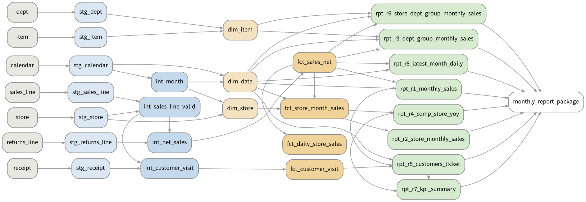
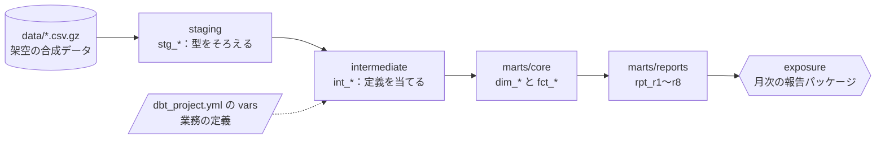

# dbt_retail_mart：月次レポートの定義を、dbt と DuckDB のマートに1回だけ書く

架空の小売「みどりマート（架空）」の合成データ（13店・2年分、レシート約13万件・明細約26万行）から、月次の報告パッケージ8本を作る dbt のプロジェクトです。
[F275](../../articles/F275_sql_change_requests) では、同じ8本を「コピペ型」「CTE 型」「共通ビュー型」の3通りの SQL で書き、定義の変更依頼が来たときに直す場所の数と、直し忘れに気づけるテストを比べました。ここでは、いちばん直しやすかった共通ビュー型を dbt のモデルに置きかえ、テストと説明を付けました。

## 何をしたか

- 業務の定義（売上として数える明細・返品の計上日・月・既存店・部門のまとめ方・客数の数え方）を、`dbt_project.yml` の `vars` と `macros/definitions.sql` に1回だけ書いた
- データの流れを staging（型をそろえる）→ intermediate（定義を当てる）→ marts（スタースキーマの次元と事実）→ reports（8本のレポート）に分けた
- テストを4種類付けた：形のテスト（一意・NULL なし・参照先がある・決まった値だけ）、照合（レポートどうしの合計が合う）、中の整合（既存店の売上 ≦ 全店など）、答え合わせ（pandas で別に計算した期待値と一致する）
- 日×店の売上は増分モデル（incremental）にした。返品は売上から最大10日後に来るので、増分の回では直近14日を読み直す
- `tools/check.py` で、F275 の8つの変更依頼を `vars` を1つ変えるだけで当て、全レポートを pandas の答えと突き合わせた

## 構成





## モデル（26本）

| 層 | モデル | 中身 |
|---|---|---|
| staging | stg_calendar・stg_store・stg_item・stg_dept・stg_receipt・stg_sales_line・stg_returns_line | CSV を読み、型をそろえる。`load_until` より後の日付は読まない（増分の確かめ用） |
| intermediate | int_month | 暦の月か、21日締めの会計月か |
| | int_sales_line_valid | 売上として数える明細（ステータス・テスト店・税込みか税抜きか） |
| | int_net_sales | 売上と返品を1つの金額の列にそろえる（返品はマイナス、計上日は返品日か元の売上日か） |
| | int_customer_visit | 客数の数え方（レシート1枚を1人か、日ごとの会員を1人か） |
| marts/core | dim_date・dim_store・dim_item | 日付・店・商品の次元（部門グループつき） |
| | fct_sales_net | 1行＝1明細の売上、または1明細の返品 |
| | fct_customer_visit | 1行＝1レシートの来店 |
| | fct_store_month_sales | 店×月の売上・前年同月の売上・既存店かどうか |
| | fct_daily_store_sales | 日×店の売上（増分モデル） |
| marts/reports | rpt_r1〜rpt_r8 | 全社・店舗別・部門グループ別・既存店前年比・客数と客単価・店舗×部門・KPI まとめ・直近月の日別 |

定義の説明は `models/docs.md` にあり、`dbt docs generate` で各モデルの説明に入ります。

## 定義を変えるとき

F275 の8つの変更依頼は、どれも `vars` を1つ変えるだけです。

| 変更依頼 | vars |
|---|---|
| CR1 返品を元の売上日に計上 | `return_date_basis: sale` |
| CR2 既存店を13か月→12か月以上 | `comp_store_min_months: 12` |
| CR3 月を21日締めの会計月に | `month_basis: fis` |
| CR4 税込み→税抜き | `amount_basis: excl` |
| CR5 テスト店を除外 | `exclude_test_store: true` |
| CR6 除外するステータスに void を追加 | `bad_status: [cancel, void]` |
| CR7 部門のまとめ方の変更 | `dept_group_version: new` |
| CR8 客数を日ごとの会員の人数に | `customer_key: member_day` |

過去の日の数字も変わるので、定義を変えたら `dbt build --full-refresh` で作り直します（増分モデルは、ふつうの回では直近14日しか読み直さないため）。

## テスト（71本）と、何を防ぐか

| 種類 | 本数 | 何を防ぐか |
|---|---|---|
| 一意・NULL なし（unique・not_null・unique_combination） | 37 | 結合で行が増える、キーが抜ける |
| 参照先がある（relationships） | 8 | 次元にない店・商品・日付の売上 |
| 決まった値だけ（accepted_values） | 4 | 知らないステータス・税率・部門グループが入る |
| 式が成り立つ（expression_is_true） | 3 | 売上がマイナス・返品がプラス、客単価×客数≠売上 |
| 照合（sums_match_by） | 7 | レポート2〜7の合計が R1 と合わない、日×店・店×月の合計が明細と合わない |
| 中の整合・データの決まり（singular） | 4 | 既存店の売上が全店を超える、R8 の合計が R1 の直近月と合わない、返品が売上より前に来る、明細とレシートの店や日付が違う |
| 答え合わせ（matches_expected） | 8 | 8本のレポートが、pandas で別に計算した期待値（`seeds/expected_*`）と合わない |

答え合わせの期待値は、境目のケース（開店日が既存店の境目の店、月末に売って翌月に返品、20日と21日の売上、void だけのレシート、同じ会員の同じ日の2回の来店、部門5・8、テスト店の売上）を入れた小さなデータ（`data/fixture_2751`、4店・レシート351件）で作りました。期待値の計算（`tools/spec.py`）は F275 と同じもので、SQL とは別に pandas で書いています。

## 結果（`results/check_result.json`）

| 確かめたこと | 結果 |
|---|---|
| 既定の定義で `dbt build` | 失敗 0。8本のレポートは pandas の答えと全行一致（答え合わせ用データ 542 行） |
| 8つの変更依頼（vars を1つ変える） | どれも build が通り、8本すべて pandas の答えと一致（変更依頼ごとに 431〜562 行） |
| 期待値を直さずに定義だけ変えたとき、答え合わせのテストが落ちるか | 8つすべてで落ちた。落ちたレポートの数は CR3・CR4 が8本、CR1・CR5・CR6 が7本、CR2・CR7・CR8 が2本（変更が届くレポートだけ） |
| 本番の大きさのデータ（13店・2年） | build が通り、8本すべて pandas の答えと一致（1,981 行） |
| 増分モデル：2月末まで積んでから3月を足した結果と、最初から作り直した結果 | 返品を返品日に数える場合も、元の売上日に数える場合も、8,670〜8,678 行すべて一致 |
| 対照：読み直しを0日にした増分（返品を元の売上日に数える場合） | 33 行がずれ、合計で 31,840 円多かった（3月に来た返品が、2月の売上日から引かれない） |

`bash run.sh` を2回、最初から回して、`results/check_result.json` が同じになることを確かめました。

## 動かし方

```bash
pip install -r requirements.txt
bash run.sh                   # データを作り、dbt build と pandas との突き合わせを回す（4分ほど）

# dbt だけを動かすとき
export DBT_PROFILES_DIR=$PWD
dbt build                                         # 答え合わせ用データ（既定）
python3 tools/generate_data.py                    # 本番の大きさのデータを data/main_2751 に作る（リポジトリには入れていない）
dbt build --full-refresh --vars '{dataset: main_2751}'
dbt build --full-refresh --vars '{month_basis: fis}'   # 定義を変える例（CR3）
python3 tools/lineage.py                          # figures/lineage.png を描き直す（graphviz が要る）
```

## ファイル

| ファイル | 中身 |
|---|---|
| dbt_project.yml・profiles.yml | プロジェクトの設定と、業務の定義（vars）。DuckDB のファイルは target/ に作る |
| models/ | staging・intermediate・marts（core・reports）のモデルと、テスト・説明の yml、定義の説明（docs.md） |
| macros/definitions.sql | 部門のまとめ方・税抜きの係数・日付の引き算 |
| tests/generic/ | 自作の汎用テスト（答え合わせ・照合・式・複数列の一意） |
| tests/*.sql | 1回きりのテスト（singular） |
| seeds/expected_r*.csv | 答え合わせの期待値（`tools/make_expected.py` が pandas で作る） |
| tools/ | データの生成（F275 と同じ）、期待値の計算、突き合わせ（check.py）、つながりの図 |
| data/fixture_2751/ | 答え合わせ用の小さなデータ |
| results/check_result.json | 突き合わせの結果 |

## 言えないこと

- データはすべて合成した架空のもので、実在の会社の数字ではありません。境目のケースは、変更依頼を知ったうえで入れています
- DuckDB でだけ動かしました。SQL Server・BigQuery・Snowflake では動かしていません（日付の関数 `strptime`・`strftime` などは書きかえが要ります）
- 期待値も同じ人が書いているので、定義の読み違いが SQL と pandas の両方に同じ形で入ると、答え合わせでは見つかりません
- 増分モデルの読み直しの日数（14日）は、このデータの返品が10日以内に来るという作りに合わせたものです。実際のデータでは、返品が来るまでの日数を測って決める必要があります
- dbt のパッケージ（dbt_utils など）は使わず、テストは自作しました。実務ではパッケージの同等のテストを使うほうが保守しやすいかもしれません（推測）
