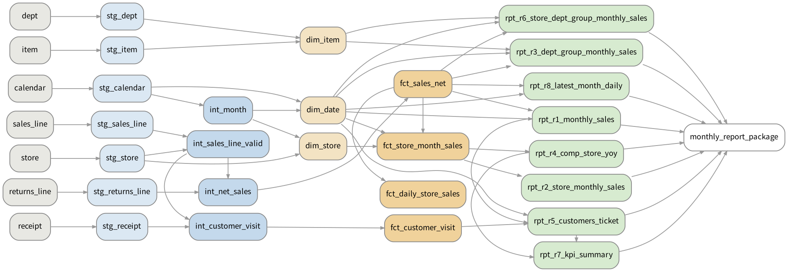
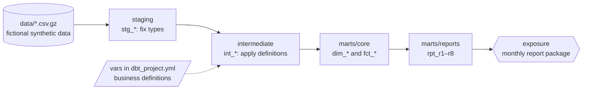

# dbt_retail_mart: writing monthly report definitions once, in a dbt + DuckDB mart

Japanese version: [README.md](README.md).

A dbt project that builds eight monthly report packages from synthetic data for a fictional retailer, "Midori Mart (fictional)" (13 stores, two years, about 130,000 receipts and 260,000 line items). In [F275](../../articles/F275_sql_change_requests/README_EN.md), the same eight reports were written in three SQL styles ("copy-paste", "CTE" and "shared views") to compare how many places must be edited when a definition changes, and which tests notice forgotten edits. Here, the easiest style to change — shared views — is rebuilt as dbt models, with tests and documentation.

## Question

Can business definitions for monthly reporting be written in exactly one place, so that a definition change is a one-line change, and so that tests catch it when reports and expected answers drift apart?

## Data

- Synthetic data generated with the same code as F275 (`tools/generate_data.py`): 13 stores (one test store, three opened mid-period), two years.
- A small answer-check dataset with edge cases (`data/fixture_2751`, 4 stores, 351 receipts): a store whose opening date sits on the same-store boundary, a sale at month-end returned the next month, sales on the 20th and 21st, a receipt with only voids, the same member visiting twice on one day, departments 5 and 8, and test-store sales.
- No real company data is used.

## What I did

- Wrote the business definitions (which line items count as sales, the booking date of returns, month, same store, department grouping, how to count customers) once, in `vars` in `dbt_project.yml` and in `macros/definitions.sql`.
- Split the flow into staging (fix types) → intermediate (apply definitions) → marts (star-schema dimensions and facts) → reports (the 8 reports).
- Added four kinds of tests: shape tests (unique, not null, referenced key exists, accepted values), reconciliation (report totals agree), internal consistency (same-store sales ≤ all stores, etc.) and answer checks (match expected values computed separately in pandas).
- Made daily × store sales an incremental model. Returns arrive up to 10 days after the sale, so each incremental run re-reads the last 14 days.
- With `tools/check.py`, applied F275's eight change requests by changing a single `vars` entry each, and matched every report against pandas.

### Structure





### Models (26)

| Layer | Model | Contents |
|---|---|---|
| staging | stg_calendar, stg_store, stg_item, stg_dept, stg_receipt, stg_sales_line, stg_returns_line | read CSVs and fix types; dates after `load_until` are not read (for testing incremental runs) |
| intermediate | int_month | calendar month, or fiscal month closing on the 21st |
| | int_sales_line_valid | line items counted as sales (status, test store, tax-inclusive or -exclusive) |
| | int_net_sales | sales and returns in one amount column (returns negative; booked on the return date or the original sale date) |
| | int_customer_visit | how customers are counted (one receipt = one person, or one member per day = one person) |
| marts/core | dim_date, dim_store, dim_item | date, store and item dimensions (with department groups) |
| | fct_sales_net | one row = one sales line or one return line |
| | fct_customer_visit | one row = one receipt visit |
| | fct_store_month_sales | store × month sales, same month last year, and same-store flag |
| | fct_daily_store_sales | day × store sales (incremental) |
| marts/reports | rpt_r1 – rpt_r8 | company-wide, by store, by department group, same-store year-on-year, customers and spend per customer, store × department, KPI summary, daily for the latest month |

Definitions are documented in `models/docs.md` and appear in each model's description via `dbt docs generate`.

### Changing a definition

Each of F275's eight change requests is a single `vars` change.

| Change request | vars |
|---|---|
| CR1 book returns on the original sale date | `return_date_basis: sale` |
| CR2 same store: 13 → 12+ months | `comp_store_min_months: 12` |
| CR3 fiscal months closing on the 21st | `month_basis: fis` |
| CR4 tax-inclusive → tax-exclusive | `amount_basis: excl` |
| CR5 exclude the test store | `exclude_test_store: true` |
| CR6 also exclude void status | `bad_status: [cancel, void]` |
| CR7 new department grouping | `dept_group_version: new` |
| CR8 customers as members per day | `customer_key: member_day` |

Past numbers change too, so after changing a definition rebuild with `dbt build --full-refresh` (normal incremental runs re-read only the last 14 days).

### Tests (71) and what they prevent

| Kind | Count | Prevents |
|---|---|---|
| unique / not null (unique, not_null, unique_combination) | 37 | joins multiplying rows, missing keys |
| relationships | 8 | sales for stores, items or dates not in the dimensions |
| accepted_values | 4 | unknown statuses, tax rates or department groups |
| expression_is_true | 3 | negative sales, positive returns, spend per customer × customers ≠ sales |
| reconciliation (sums_match_by) | 7 | totals of reports 2–7 not matching R1; day × store and store × month totals not matching line items |
| internal consistency and data rules (singular) | 4 | same-store sales above all stores, R8 total not matching R1's latest month, returns before the sale, store or date differing between line items and receipts |
| answer checks (matches_expected) | 8 | any of the 8 reports not matching the pandas expected values (`seeds/expected_*`) |

Expected values for answer checks were computed on the small edge-case dataset. The calculation (`tools/spec.py`) is the same as in F275 and written in pandas, separately from the SQL.

## Findings

From `results/check_result.json`:

| Check | Result |
|---|---|
| `dbt build` with default definitions | 0 failures; the 8 reports match pandas on every row (542 rows of answer-check data) |
| The 8 change requests (one `vars` change each) | every build passed and all 8 reports matched pandas (431–562 rows per change) |
| Changing only the definition without updating expected values: do answer checks fail? | they failed for all 8. Reports failing: 8 for CR3 and CR4; 7 for CR1, CR5 and CR6; 2 for CR2, CR7 and CR8 (only the reports the change reaches) |
| Production-sized data (13 stores, 2 years) | build passed and all 8 reports matched pandas (1,981 rows) |
| Incremental: load through end of February, then add March, vs full rebuild | identical on all 8,670–8,678 rows, whether returns are booked on the return date or the original sale date |
| Control: incremental with 0 days of re-reading (returns booked on the sale date) | 33 rows differed, 31,840 yen too high in total (returns arriving in March were not subtracted from February sale dates) |

Running `bash run.sh` twice from scratch produced identical `results/check_result.json`.

## Running it daily with an orchestrator (Dagster)

[orchestration/](orchestration/README_EN.md) defines the same mart in the orchestrator Dagster as "generate data → dbt build (tests as asset checks) → match against pandas". If a test fails, it stops without running the later steps and writes a notice to `target/alerts.log`. Two runs produced identical table contents, and changing only the definition while forgetting to update expected values stopped the pipeline as intended.

## What this does not show

- All data is synthetic and fictional, not a real company's numbers. The edge cases were added knowing the change requests.
- Run on DuckDB only. Not run on SQL Server, BigQuery or Snowflake (date functions such as `strptime` and `strftime` would need rewriting).
- The same person wrote the expected values, so a misreading of a definition that enters both the SQL and pandas in the same way would not be caught by answer checks.
- The 14-day re-read window matches this data's design (returns arrive within 10 days). With real data, measure how long returns take before choosing it.
- No dbt packages (such as dbt_utils) were used; tests were written by hand. In practice, equivalent package tests may be easier to maintain (my interpretation).

## How to use this at work

- Keep definitions as `vars` and macros so a definition change is reviewable in one line.
- Combine reconciliation tests with answer checks on a small dataset full of edge cases; reconciliation alone misses consistent mistakes (see F275).
- For incremental models fed by late-arriving data, set the re-read window from measured delays and test it against a full rebuild.

## Reproduce

```bash
pip install -r requirements.txt
bash run.sh                   # generates data, runs dbt build and matches against pandas (about 4 minutes)

# dbt only
export DBT_PROFILES_DIR=$PWD
dbt build                                         # answer-check data (default)
python3 tools/generate_data.py                    # production-sized data into data/main_2751 (not stored in the repository)
dbt build --full-refresh --vars '{dataset: main_2751}'
dbt build --full-refresh --vars '{month_basis: fis}'   # example of changing a definition (CR3)
python3 tools/lineage.py                          # redraws figures/lineage.png (needs graphviz)
```

## Files

| File | Contents |
|---|---|
| dbt_project.yml, profiles.yml | project settings and the business definitions (vars); the DuckDB file is created in target/ |
| models/ | staging, intermediate and marts (core, reports) models, yml for tests and descriptions, definition notes (docs.md) |
| macros/definitions.sql | department grouping, tax-exclusive factor, date subtraction |
| tests/generic/ | hand-written generic tests (answer check, reconciliation, expression, multi-column unique) |
| tests/*.sql | one-off (singular) tests |
| seeds/expected_r*.csv | expected values for answer checks (built in pandas by `tools/make_expected.py`) |
| tools/ | data generation (same as F275), expected values, matching (check.py), lineage figure |
| data/fixture_2751/ | the small answer-check dataset |
| results/check_result.json | matching results |
| orchestration/ | the Dagster definition and its test results |
