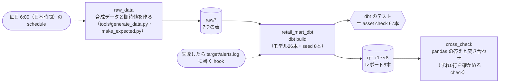

# 実行管理：dbt のマートを Dagster で毎日回す

[dbt_retail_mart](../README.md)（架空の小売「みどりマート（架空）」の月次レポートを dbt と DuckDB で作るマート）を、実行管理のツール Dagster で動かす定義です。データを作る段、dbt build の段、pandas との突き合わせの段を順につなぎ、どこかで落ちたら後ろの段を動かさずに止めます。手元（1台の PC）で動かしたもので、本番の運用ではありません。

## なぜ
`run.sh` は上から順にコマンドを流すだけなので、途中のテストが落ちたときにどこで止まったか、どの表が古いままかが分かりにくい。実行管理のツールに載せると、表ごと（asset）に「いつ作られたか」「テストが通ったか」が残り、落ちたときに後ろの段を自動で止められます。dbt のテストは、そのまま Dagster の asset check（表ごとの確かめ）になります。

## 構成



| 段（asset） | 中身 |
|---|---|
| `raw/*`（7つ） | `tools/generate_data.py` で合成データを作り直し、`tools/make_expected.py` で答え合わせの期待値（seeds/expected_*）を作る。種は 2751 で固定 |
| dbt のモデル・seed（34） | `dbt build --full-refresh`。dbt の source（raw.*）を上の `raw/*` に結びつけている |
| dbt のテスト（67本の asset check） | 一意・NULL なし・参照先・決まった値・照合・答え合わせなど。1本でも落ちると dbt の段が失敗する |
| `cross_check` | レポート8本を `tools/check.py` の `compare_all` で pandas の答えと突き合わせる。ずれが1行でもあれば check `no_mismatch` が落ちる |

- 毎日の実行：`daily_mart_0600_jst`（毎日 6:00、日本時間）。動かすには Dagster の常駐の仕組み（daemon）が要る
- 失敗の知らせ：段が失敗すると、その段の名前と時刻を `target/alerts.log` に1行で書き、標準エラーにも `ALERT` で出す（手元での知らせの代わり）
- 定義を変えて試すとき：dbt の段の設定 `vars_json` に、dbt の `--vars` と同じ JSON を渡す

## 動かし方
`projects/dbt_retail_mart` のフォルダで：

```bash
pip install -r requirements.txt -r orchestration/requirements.txt
export DBT_PROFILES_DIR=$PWD
dagster job execute -m orchestration.definitions -j daily_mart                                   # いつもの実行
dagster job execute -m orchestration.definitions -j daily_mart -c orchestration/config_break.yaml   # わざと落とす
python3 orchestration/snapshot.py > snap.json   # 実行後の表ごとの行数とハッシュ（2回流して比べる用）

# 画面で見るとき（dagster-webserver を入れる）
dagster dev -m orchestration.definitions
```

## 試した結果（2026-11-14）

### いつもの実行：2回流して同じ結果
- `target/`・`data/main_2751` などを消した状態から2回流し、2回とも成功した（1回あたり約75秒）
- 1回の実行で、asset の作成42件、asset check 68件（dbt のテスト67本＋突き合わせ1本）がすべて通った。dbt の集計は PASS=105・ERROR=0
- 実行後の表（ビューを含む26個）の行数とハッシュ、突き合わせの結果（`target/cross_check.json`）は、2回で完全に一致した

### わざと落とした実行：後ろの段は動かない
`orchestration/config_break.yaml` で、既存店の定義を「開店から13か月目から」→「12か月目から」に変え（[F275](../../../articles/F275_sql_change_requests) の変更依頼 CR2）、答え合わせの期待値は直さないまま（`force_golden`）にした。定義だけ変えて期待値を直し忘れた状態のまねです。

```
raw_data - STEP_SUCCESS - Finished execution of step "raw_data" in 7.91s.
retail_mart_dbt - ASSET_CHECK_EVALUATION - Asset check 'matches_expected_rpt_r4_comp_store_yoy_...' on 'rpt_r4_comp_store_yoy' did not pass.
retail_mart_dbt - ASSET_CHECK_EVALUATION - Asset check 'matches_expected_rpt_r7_kpi_summary_...' on 'rpt_r7_kpi_summary' did not pass.
retail_mart_dbt - STEP_FAILURE - Execution of step "retail_mart_dbt" failed.
RUN_FAILURE - Execution of run for "daily_mart" failed. Steps failed: ['retail_mart_dbt'].
ALERT 2026-11-14T11:30:28+00:00	FAILED	retail_mart_dbt	run=0a3c1599-...
```

- 既存店を使う2本（R4 既存店の前年比・R7 KPI の要約）の答え合わせが落ち、dbt の集計は PASS=103・ERROR=2 だった
- dbt の段が失敗として止まり、後ろの `cross_check` は始まらなかった。実行全体の終了コードは 1
- `target/alerts.log` に、失敗した段の名前と時刻が1行書かれた

## 言えないこと
- 手元の1台で動かしただけで、本番の運用ではありません。毎日の schedule は定義しただけで、常駐の仕組み（daemon）で何日も回したわけではありません
- 失敗の知らせはファイルに1行書くだけです。実務では Slack やメールに送る仕組みにつなぐ必要があります
- dbt の段は、テストが落ちてもモデル（表やビュー）自体は作ってしまいます。止まるのは Dagster の後ろの段（突き合わせ）からです。落ちたテストの表を後ろで使わせたくないなら、dbt のテストの重さ（severity）や、表を作る順番の設計を考える必要があります（推測）
- dbt-core 1.12 と Dagster の依存（protobuf の版）がぶつかるので、版をそろえて入れています（requirements.txt）。版を上げるときは組み合わせを確かめ直す必要があります
- データはすべて合成した架空のものです
