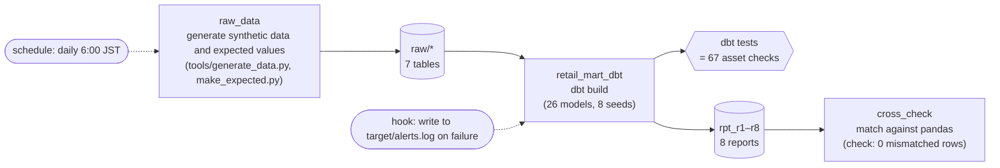

# Orchestration: running the dbt mart daily with Dagster

Japanese version: [README.md](README.md). Parent project: [dbt_retail_mart](../README_EN.md).

A Dagster (orchestration tool) definition that runs [dbt_retail_mart](../README_EN.md) — a dbt + DuckDB mart producing monthly reports for the fictional retailer "Midori Mart (fictional)". It chains a data-generation step, a dbt build step and a step that matches results against pandas, and if any step fails it stops without running later steps. It was run on one local PC; it is not a production deployment.

## Question

`run.sh` simply runs commands from top to bottom, so when a test fails partway it is hard to see where it stopped and which tables are stale. Can an orchestrator record, per table (asset), when it was built and whether its tests passed, and automatically stop downstream steps on failure? (dbt tests become Dagster asset checks as they are.)

## Data

The same fictional synthetic data as the parent project, regenerated on every run (seed fixed at 2751). No real company data.

## What I did



| Step (asset) | Contents |
|---|---|
| `raw/*` (7) | regenerate synthetic data with `tools/generate_data.py` and answer-check expected values (seeds/expected_*) with `tools/make_expected.py`; seed fixed at 2751 |
| dbt models and seeds (34) | `dbt build --full-refresh`; dbt sources (raw.*) are linked to the `raw/*` assets above |
| dbt tests (67 asset checks) | unique, not null, relationships, accepted values, reconciliation, answer checks, etc.; if any fails, the dbt step fails |
| `cross_check` | matches the 8 reports against pandas with `compare_all` in `tools/check.py`; the check `no_mismatch` fails if even one row differs |

- Daily run: `daily_mart_0600_jst` (every day at 6:00 JST). Running it on a schedule requires Dagster's daemon.
- Failure notice: when a step fails, a hook writes one line with the step name and time to `target/alerts.log` and prints `ALERT` to standard error (a local stand-in for real notifications).
- To try a different definition: pass the same JSON as dbt's `--vars` to the dbt step's `vars_json` setting.

## Findings (14 Nov 2026)

### Normal run: two runs, same result

- Starting from a state with `target/`, `data/main_2751` etc. deleted, it ran twice and succeeded both times (about 75 seconds each).
- Each run materialized 42 assets and passed all 68 asset checks (67 dbt tests + 1 cross-check). dbt reported PASS=105, ERROR=0.
- Row counts and hashes of the tables after the run (26 including views) and the cross-check result (`target/cross_check.json`) were identical across the two runs.

### Deliberately broken run: later steps do not run

`orchestration/config_break.yaml` changes the same-store definition from "13 months after opening" to "12 months" ([F275](../../../articles/F275_sql_change_requests/README_EN.md) change request CR2) while leaving the answer-check expected values unchanged (`force_golden`) — imitating "definition changed, expected values forgotten".

```
raw_data - STEP_SUCCESS - Finished execution of step "raw_data" in 7.91s.
retail_mart_dbt - ASSET_CHECK_EVALUATION - Asset check 'matches_expected_rpt_r4_comp_store_yoy_...' on 'rpt_r4_comp_store_yoy' did not pass.
retail_mart_dbt - ASSET_CHECK_EVALUATION - Asset check 'matches_expected_rpt_r7_kpi_summary_...' on 'rpt_r7_kpi_summary' did not pass.
retail_mart_dbt - STEP_FAILURE - Execution of step "retail_mart_dbt" failed.
RUN_FAILURE - Execution of run for "daily_mart" failed. Steps failed: ['retail_mart_dbt'].
ALERT 2026-11-14T11:30:28+00:00	FAILED	retail_mart_dbt	run=0a3c1599-...
```

- The answer checks failed for the two reports that use the same-store definition (R4 same-store year-on-year, R7 KPI summary); dbt reported PASS=103, ERROR=2.
- The dbt step stopped as a failure and the downstream `cross_check` never started. The run's exit code was 1.
- One line with the failed step name and time was written to `target/alerts.log`.

## What this does not show

- It was run on one local machine, not in production. The daily schedule was only defined; it was not run for days with the daemon.
- The failure notice only writes a line to a file. In practice it would need to be connected to Slack or email.
- The dbt step still builds the models (tables and views) even when tests fail; the stop happens from Dagster's downstream steps (the cross-check). To prevent downstream use of tables whose tests failed, dbt test severity or build order would need to be designed (my interpretation).
- dbt-core 1.12 and Dagster conflict on a dependency (protobuf version), so versions are pinned together (requirements.txt). When upgrading, the combination must be re-checked.
- All data is synthetic and fictional.

## How to use this at work

- Represent each table as an asset with its tests as checks, so a failed check visibly blocks downstream work instead of silently producing stale reports.
- Keep a "deliberately broken" config to prove that the pipeline really stops when it should.
- Compare row counts and hashes across repeated runs to confirm the pipeline is deterministic.

## Reproduce

In the `projects/dbt_retail_mart` folder:

```bash
pip install -r requirements.txt -r orchestration/requirements.txt
export DBT_PROFILES_DIR=$PWD
dagster job execute -m orchestration.definitions -j daily_mart                                   # normal run
dagster job execute -m orchestration.definitions -j daily_mart -c orchestration/config_break.yaml   # deliberately broken
python3 orchestration/snapshot.py > snap.json   # row counts and hashes per table after a run (to compare two runs)

# to view in a browser (install dagster-webserver)
dagster dev -m orchestration.definitions
```

## Files

| File | Contents |
|---|---|
| definitions.py | assets, asset checks, job, schedule and failure hook |
| config_break.yaml | config for the deliberately broken run |
| snapshot.py | row counts and hashes of tables after a run |
| requirements.txt | pinned versions of Dagster, dagster-dbt and protobuf |
